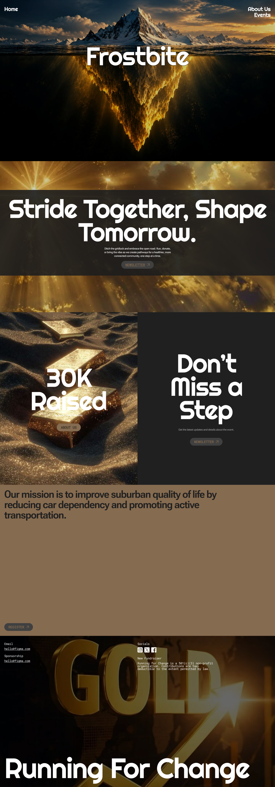
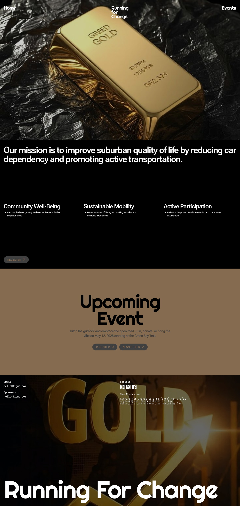
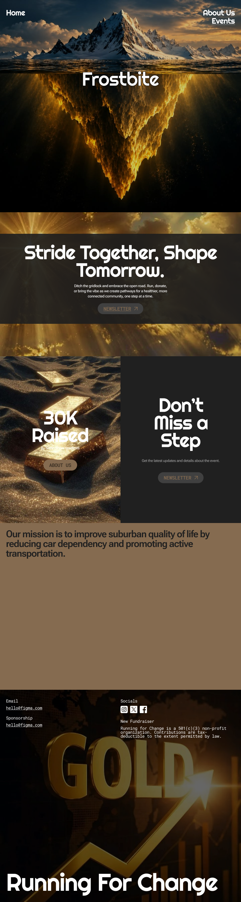
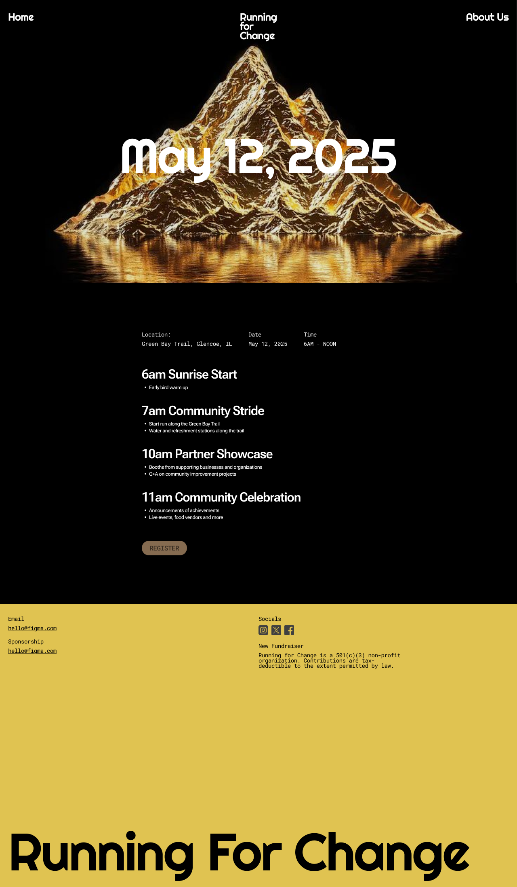
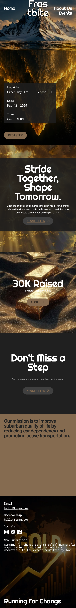
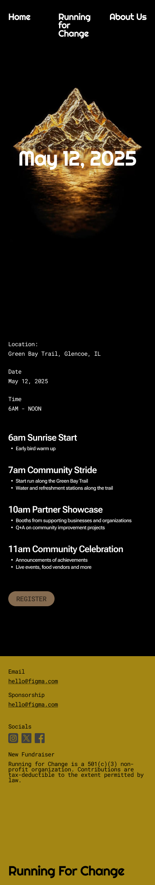
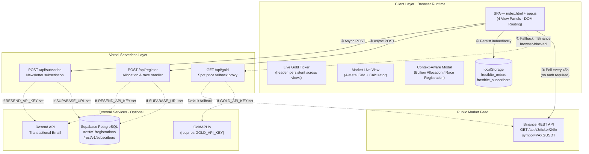

# Frostbite
### *Sovereign Physical & Digital Gold Intelligence Platform*

[](https://frostbite-taupe.vercel.app)
[](https://frostbite-taupe.vercel.app)
[](#06-technology-stack)
[](#06-technology-stack)
[](#06-technology-stack)

---

## ⚡ 60-Second Summary
> **Frostbite** is a zero-framework, single-page web application built for **HackInHills 2026** that unifies **real-time precious metals intelligence** with a **community fundraiser event hub**.
> It queries the Binance public REST API for live gold spot pricing (via PAXG/USDT) — no paid API key required — and derives Silver, Platinum, and Palladium estimates in real-time using established market ratios.
> The platform features institutional-grade UI interactions, a dual-context registration modal, three Vercel serverless backend functions, and optional cloud persistence via Supabase and email dispatch via Resend.

---

## 🔗 Project Resources & Links

| Resource | Link | Description |
| :--- | :--- | :--- |
| 🎬 **LinkedIn Pitch Video** | [Watch on LinkedIn](https://lnkd.in/p/djbNYUpr) | Competition concept pitch and walkthrough |
| 🖥️ **Prototype Demonstration** | [View Video Demo (Google Drive)](https://drive.google.com/file/d/1OSgYeKWHo8GKuMF1qOdHjajBJ38n4lEd/view?usp=drivesdk) | Screen capture demonstration of live application |
| 📊 **Project Presentation (PPT)** | [View Slides (Google Drive)](https://drive.google.com/file/d/1ea4lmIMMOzRFWw52CDiPqJ2Ktl1lycLx/view?usp=drivesdk) | HackInHills 2026 official pitch deck |
| 🌐 **Live Web Application** | [frostbite-taupe.vercel.app](https://frostbite-taupe.vercel.app) | Production deployment hosted on Vercel |
| 🐙 **Source Code Repository** | [github.com/samuelmichaelalva/frostbite](https://github.com/samuelmichaelalva/frostbite) | Public GitHub repository |

---

## 📑 Project Details

| Parameter | Specification |
| :--- | :--- |
| **Hackathon** | HackInHills 2026 |
| **Category** | FinTech / Commodity Intelligence |
| **Live Deployment** | [frostbite-taupe.vercel.app](https://frostbite-taupe.vercel.app) |
| **Repository** | [github.com/samuelmichaelalva/frostbite](https://github.com/samuelmichaelalva/frostbite) |
| **Architecture** | Zero-Framework SPA · Vercel Serverless · Binance Public API |
| **Status** | Hackathon Prototype |

---

## Table of Contents

* [Project Resources & Links](#-project-resources--links)
* [01. Project Overview](#01-project-overview)
* [02. Problem Statement & Solution](#02-problem-statement--solution)
* [03. Key Features](#03-key-features)
* [04. Screenshots & Live Demo](#04-screenshots--live-demo)
* [05. System Architecture](#05-system-architecture)
* [06. Technology Stack](#06-technology-stack)
* [07. Project Structure](#07-project-structure)
* [08. Installation & Setup](#08-installation--setup)
* [09. API Reference](#09-api-reference)
* [10. Environment Variables](#10-environment-variables)
* [11. Team & Contributions](#11-team--contributions)
* [12. Prototype Limitations](#12-prototype-limitations)

---

## 01. Project Overview

Frostbite demonstrates a production-grade web application architecture for a sovereign physical and digital gold custody platform, combined with an integrated community fundraiser event system.

The application is a **zero-framework Single-Page Application (SPA)**: all four views (Home, Bullion Reserves, Market Live, and Event) exist within a single `index.html`, with DOM-based view switching handled entirely by vanilla JavaScript — no React, Vue, Angular, or router library required.

At its core, Frostbite addresses a gap in accessible commodity intelligence: obtaining real-time, authoritative gold spot pricing without a paid API subscription. It achieves this by integrating directly with the Binance public REST API, using `PAXGUSDT` — the ticker for PAX Gold, a token backed 1:1 by one fine troy ounce of physical gold held in LBMA-certified custody.

The platform additionally includes a community fundraiser hub for **Frostbite: Running For Change**, a charity run event (May 12, 2025 · Green Bay Trail, Glencoe, IL), complete with race registration, event schedule, and participant categories — served through the same unified modal dialog system that handles bullion allocation inquiries.

---

## 02. Problem Statement & Solution

### The Problem

Three distinct friction points motivated Frostbite's design:

1. **Commodity Data Access Barriers**: Real-time precious metals feeds for Gold, Silver, Platinum, and Palladium typically require paid subscriptions (e.g., GoldAPI.io, Metals API, Bloomberg Terminal). This creates a significant barrier for academic prototypes, indie developers, and small-scale fintech demonstrations.

2. **Pricing Opacity and Unit Confusion**: End-users face genuine opacity when evaluating gold investments: troy ounce vs gram conversions, fineness standards (995.0 vs 999.9), and percentage-based price changes are rarely surfaced together in an accessible, real-time interface.

3. **Platform Fragmentation**: Community fundraising and asset-stewardship typically operate on entirely separate platforms, requiring users to context-switch between multiple dashboards and registration systems.

### The Solution

| Problem | Frostbite's Approach |
| :--- | :--- |
| Paid API barrier | Queries Binance `PAXGUSDT` public ticker — no authentication required |
| Silver/Platinum/Palladium data cost | Derives estimates mathematically from live gold using proven market ratios |
| Unit conversion friction | Built-in Gold Value Calculator: live USD → troy oz → gram conversion |
| Platform fragmentation | Single unified modal handles both bullion allocation and event registration |
| Backend dependency | Local-first persistence to `localStorage`; serverless backend is optional |

---

## 03. Key Features

### Live Commodity Intelligence
* **Real-time Gold Spot Price** fetched from the Binance public REST API (`PAXGUSDT`, 24-hour ticker). PAXG is backed 1:1 by physical gold held in LBMA-certified vaults, making its exchange price a reliable proxy for XAU/USD.
* **Four-Metal Dashboard**: Gold (XAU), Silver (XAG), Platinum (XPT), and Palladium (XPD) displayed simultaneously. Silver, Platinum, and Palladium are derived from the live gold price using historical baseline ratios (see Architecture).
* **Auto-refresh** via `setInterval` every 45 seconds; timestamp indicator shows the exact fetch time and live/estimate status.
* **Feed source label** updates dynamically in the UI to indicate whether data is `✦ PAXG/USDT · Binance · LIVE` or falling back to a baseline estimate.

### Gold Value Calculator
* Interactive input accepting any USD amount; computes equivalent troy ounces (`USD ÷ spot`) and fine grams (`oz × 31.1035`) in real-time against the live spot price.
* The same calculation drives the live badge on the Home view: `$30,000 ÷ spot = N troy oz`.

### Zero-Framework SPA Navigation
* All four views (`Home`, `Reserves`, `Market Live`, `Event`) are `<div class="view-panel">` sections inside a single `index.html`.
* Navigation uses `data-target` attributes on `<button>` elements; the `switchView()` function in `app.js` toggles the CSS `.active` class with `opacity + translateY` transitions animated via `cubic-bezier(0.16, 1, 0.3, 1)`.

### Context-Aware Modal Dialog
* A single `#allocate-modal` dialog is reused across all pages.
* When the active view is `event`, the modal dynamically reconfigures its title, subtitle, and `<select>` options to show race participation categories (5K Community Run, 10K Trail Run, Partner Booth).
* On all other views, the modal presents gold bullion allocation tiers (10 Troy Ounces, 1 Kilogram Bar, Institutional Ingot).

### Local-First Offline Persistence
* Form submissions (allocation orders and newsletter subscriptions) are written to `localStorage` (`frostbite_orders`, `frostbite_subscribers`) immediately, before any network call.
* Asynchronous POSTs to `/api/register` and `/api/subscribe` are attempted silently; the UI gives accurate feedback regardless of whether the serverless backend is reachable.

### Interaction Physics
* **Pointer-follow ambient glow**: A `radial-gradient` overlay tracks cursor position via the `pointermove` event, creating a subtle atmospheric lighting effect.
* **3D card tilt**: `.card-3d` elements apply `perspective(800px) rotateX rotateY` transforms based on normalized pointer coordinates within each card's bounding box.
* **Spring-physics easing**: All transitions use `cubic-bezier(0.16, 1, 0.3, 1)` throughout CSS — a spring-like easing curve.

### Research Desk Portal (`login.html`)
* A standalone authentication page with Tailwind CSS (CDN), JetBrains Mono typography, and a molten gold backdrop.
* Features a mode-toggle between "Login" and "Request Access" states, dynamically showing/hiding name, API key, and "Remember Desk" fields.

---

## 04. Screenshots & Live Demo

**Live Application:** [frostbite-taupe.vercel.app](https://frostbite-taupe.vercel.app)

### Application Views

| Home View | Bullion Reserves View |
| :---: | :---: |
|  |  |
| *Live spot badge, 3D card physics, newsletter form* | *Three-pillar custody framework, mission banner* |

| Market Live View | Event Registration View |
| :---: | :---: |
|  |  |
| *Four-metal commodity grid, gold value calculator* | *Race schedule timeline, context-aware modal* |

### Mobile Responsiveness

| Home | Reserves | Event |
| :---: | :---: | :---: |
|  |  |  |

---

## 05. System Architecture

Frostbite uses a decoupled architecture where the client layer handles all rendering and market data acquisition directly from public endpoints. Vercel serverless functions provide an optional fallback layer for data, plus cloud persistence and email when configured.



### Derived Commodity Pricing

Only Gold (XAU) is sourced from a live market feed. The other three metals are computed client-side using baseline ratios applied to the live gold price:

| Metal | Symbol | Derivation Formula | Baseline Ratio |
| :--- | :---: | :--- | :--- |
| Gold | XAU | Direct — Binance PAXGUSDT | — |
| Silver | XAG | `gold_price ÷ 85` | 85 : 1 |
| Platinum | XPT | `gold_price ÷ 2.8` | 2.8 : 1 |
| Palladium | XPD | `gold_price ÷ 2.6` | 2.6 : 1 |

> **Note:** Silver, Platinum, and Palladium prices are reference estimates, not independently sourced live feeds. They are clearly labelled as "Reference Estimate" in the UI.

### Gold Value Conversion

$$\text{Troy Ounces} = \frac{\text{USD Amount}}{\text{Gold Spot Price (PAXGUSDT)}}$$

$$\text{Fine Grams} = \text{Troy Ounces} \times 31.1035$$

---

## 06. Technology Stack

### Frontend
| Component | Technology | Detail |
| :--- | :--- | :--- |
| **Markup** | HTML5 | Semantic, single-file SPA structure |
| **Logic** | Vanilla JavaScript (ES6+) | Zero external framework; `async/await`, `fetch`, DOM API |
| **Styling** | Custom CSS3 | CSS custom properties, flexbox, grid, hardware-accelerated transforms |
| **Typography** | Google Fonts | `Syne` (display) · `Plus Jakarta Sans` (body) · `Space Mono` (data) |
| **Login Portal** | Tailwind CSS (CDN) + `JetBrains Mono` | Used exclusively in `login.html` |

### Backend (Vercel Serverless)
| Component | Technology | Detail |
| :--- | :--- | :--- |
| **Runtime** | Node.js (Vercel Functions) | ES Module serverless handlers |
| **Market Data** | Binance Public REST API | `PAXGUSDT` 24hr ticker — no authentication |
| **Premium Data** | GoldAPI.io | Optional; activated by `GOLD_API_KEY` env var |
| **Database** | Supabase (PostgreSQL) | Optional; REST API for `registrations` and `subscribers` tables |
| **Email** | Resend API | Optional; transactional confirmations via `onboarding@resend.dev` |

### Infrastructure
| Component | Technology |
| :--- | :--- |
| **Hosting** | Vercel (static CDN + serverless) |
| **Routing** | `vercel.json` rewrite rules for `/api/*` |
| **Assets** | WebP (production), JPEG (source originals) |

---

## 07. Project Structure

```
frostbite/
├── index.html                    # Main SPA — Home, Reserves, Market Live, Event views
├── login.html                    # Research Desk access & authentication portal
├── app.js                        # All client-side logic: routing, live data, forms, physics
├── style.css                     # Design system: tokens, components, animations, responsive
├── vercel.json                   # API route rewrites for Vercel deployment
│
├── api/
│   ├── gold.js                   # GET /api/gold — Spot price (GoldAPI.io → Binance fallback)
│   ├── register.js               # POST /api/register — Allocation/race order handler
│   └── subscribe.js              # POST /api/subscribe — Newsletter subscription handler
│
├── assets/                       # Optimised WebP visuals used in production
│   ├── home_hero_iceberg.webp    # Home view hero image
│   ├── about_gold_bar.webp       # Reserves view hero image
│   ├── event_mountain.webp       # Market Live & Event views hero image
│   ├── gold_bars_sand.webp       # Home — $30K allocation card background
│   ├── golden_rays.webp          # Atmospheric overlay asset
│   └── footer_gold.webp          # Footer visual
│
├── images/                       # High-resolution source images
│   ├── hero_iceberg.jpg
│   ├── gold_bar.jpg
│   ├── gold_sand.jpg
│   ├── golden_mountain.jpg
│   ├── molten_gold.jpg
│   ├── gold_arrow.jpg
│   ├── sunburst.jpg
│   └── references/               # UI reference layout captures
│       ├── mobile_home.png
│       ├── mobile_specs.png
│       ├── mobile_timeline.png
│       ├── tablet_home.png
│       ├── tablet_specs.png
│       └── tablet_timeline.png
│
├── Home_Desktop.png              # Screenshot — Home view, desktop
├── Home_Tablet.png               # Screenshot — Home view, tablet
├── Home_Mobile.png               # Screenshot — Home view, mobile
├── About_Desktop.png             # Screenshot — Reserves view, desktop
├── About_Tablet.png              # Screenshot — Reserves view, tablet
├── About_Mobile.png              # Screenshot — Reserves view, mobile
├── Event_Desktop.png             # Screenshot — Event view, desktop
├── Event_Tablet.png              # Screenshot — Event view, tablet
├── Event_Mobile.png              # Screenshot — Event view, mobile
└── README.md
```

---

## 08. Installation & Setup

### Prerequisites
* Any modern browser (Chrome 90+, Firefox 88+, Safari 14+, Edge 90+)
* **Optional** for local development: [Python 3](https://python.org) or [Node.js v18+](https://nodejs.org)
* **Optional** for serverless API routes: [Vercel CLI](https://vercel.com/cli)

---

### Step 1: Clone the Repository
```bash
git clone https://github.com/samuelmichaelalva/frostbite.git
cd frostbite
```

---

### Step 2: Serve Locally

The frontend requires no build step. Choose any static server:

**Option A — Python 3 (simplest)**
```bash
python -m http.server 8000
```

**Option B — Node.js**
```bash
npx -y serve .
```

**Option C — Vercel CLI (recommended — also runs `/api/*` serverless functions)**
```bash
npx -y vercel dev
```

Then open `http://localhost:8000` (or the Vercel dev URL) in your browser.

> The live gold price feed works without any configuration — the app queries Binance's public API directly from the browser. Serverless functions are only needed if you want email dispatch or cloud database writes.

---

### Step 3: Configure Environment Variables (Optional)

If deploying to Vercel and you want email and database features enabled, add these in your Vercel project dashboard under **Settings → Environment Variables**:

| Variable | Service | Purpose |
| :--- | :--- | :--- |
| `GOLD_API_KEY` | GoldAPI.io | Premium gold spot data in `/api/gold` (Binance is the default if omitted) |
| `RESEND_API_KEY` | Resend.com | Transactional email dispatch from `/api/register` and `/api/subscribe` |
| `SUPABASE_URL` | Supabase | Cloud PostgreSQL instance URL |
| `SUPABASE_KEY` | Supabase | Anon or service role key for Supabase REST API |

---

## 09. API Reference

All three API functions are Vercel Serverless Functions (Node.js ES Modules).

---

### `GET /api/gold`

Returns the current gold spot price with an equivalent troy oz/gram calculation against a fixed $30,000 reference.

**Response Headers:**
```
Access-Control-Allow-Origin: *
Cache-Control: s-maxage=60, stale-while-revalidate=120
```

**Response Body (200 OK):**
```json
{
  "price": 2748.60,
  "currency": "USD",
  "unit": "troy oz",
  "change24h": "+0.62%",
  "raisedUsd": 30000,
  "goldEquivalent": {
    "oz": "10.91",
    "grams": "339.4"
  },
  "updatedAt": "2026-10-29T00:00:00.000Z"
}
```

**Data source fallback chain:**
1. `GoldAPI.io` — if `GOLD_API_KEY` env var is set
2. `Binance PAXGUSDT` — public ticker, no key required
3. Hardcoded baseline (`$2748.60`) with `±1` jitter — if all network calls fail

---

### `POST /api/register`

Handles bullion allocation inquiries and race event registrations.

**Request Body (application/json):**
```json
{
  "name": "Jane Doe",
  "email": "jane@example.com",
  "participationType": "10 Troy Ounces (~$27,500)"
}
```

**Response Body (200 OK):**
```json
{
  "success": true,
  "message": "Registration confirmed",
  "cloudSynced": false,
  "emailSent": false
}
```

**Backend actions (each conditional on env vars):**
1. `POST {SUPABASE_URL}/rest/v1/registrations` — if Supabase configured
2. `POST https://api.resend.com/emails` — if Resend configured; sends confirmation to `email`

---

### `POST /api/subscribe`

Registers an email address for market price alerts and event updates.

**Request Body (application/json):**
```json
{
  "email": "investor@example.com"
}
```

**Response Body (200 OK):**
```json
{
  "success": true,
  "message": "Subscribed",
  "cloudSynced": false,
  "emailSent": false
}
```

**Backend actions (each conditional on env vars):**
1. `POST {SUPABASE_URL}/rest/v1/subscribers` — if Supabase configured
2. `POST https://api.resend.com/emails` — if Resend configured; sends welcome email

---

## 10. Environment Variables

All environment variables are optional. The application functions fully in prototype mode without any configuration.

| Variable | Required | Default Behaviour When Absent |
| :--- | :---: | :--- |
| `GOLD_API_KEY` | No | `/api/gold` falls back to Binance public ticker |
| `RESEND_API_KEY` | No | Emails are not sent; `emailSent: false` returned |
| `SUPABASE_URL` | No | Submissions not persisted to cloud; `cloudSynced: false` returned |
| `SUPABASE_KEY` | No | Required alongside `SUPABASE_URL` for database writes |

> Without any environment variables, the gold price feeds live from Binance, and all form data is persisted to `localStorage` only.

---

## 11. Team & Contributions

Frostbite was built as a HackInHills 2026 prototype by a three-member team.

---

### Core Team

**Samuel Michael Alva — Team Lead & Lead Engineer**

Samuel designed and implemented the entire technical architecture of Frostbite. His contributions span every layer of the codebase, as verified by the repository commit history:

* **SPA Architecture & Frontend Engineering** — Designed the zero-framework SPA structure in `index.html` and `app.js`: view-panel layout, `switchView()` DOM router, CSS transition system, and all four application views (Home, Reserves, Market Live, Event).
* **Live Market Integration** — Engineered the Binance `PAXGUSDT` public API integration, the multi-tier fallback chain (browser → `/api/gold` → baseline), the 45-second auto-polling engine, and the derived multi-commodity ratio calculation system.
* **Gold Value Calculator** — Implemented the real-time USD → troy oz → gram conversion system wired to the live spot price.
* **Interaction Design** — Built the pointer-follow ambient radial glow, 3D card tilt physics, spring-physics CSS easing system, and the context-aware modal dialog.
* **Vercel Serverless Backend** — Authored all three serverless API functions (`api/gold.js`, `api/register.js`, `api/subscribe.js`) including the GoldAPI/Binance data source fallback, Supabase REST integration, and Resend email dispatch.
* **Research Desk Portal** — Designed and built the standalone `login.html` authentication portal with Tailwind CSS, JetBrains Mono typography, and dynamic form-state toggling.
* **CSS Design System** — Authored `style.css`: CSS custom property tokens, responsive hero layouts, commodity grid, timeline, modal, and footer components.
* **Mobile Responsiveness** — Fixed viewport locking, eliminated horizontal overflow, and ensured layout integrity across mobile, tablet, and desktop viewports.
* **Repository Management** — Sole committer across all technical commits; authored all feature branches and documentation.

---

**Vasanth Augustine Nadar — Hackathon Team Member**

Vasanth contributed to the ideation phase and collaborative problem definition at HackInHills 2026. The team's shared research into commodity derivatives accessibility and the platform's dual-use concept (asset intelligence + community fundraising) reflects group-level input during the hackathon.

---

**Sidra Zulfikar Dingankar — Hackathon Team Member**

Sidra contributed to the ideation phase, project scoping, and the creation of presentation assets submitted for the hackathon. The team's framing of the problem statement around institutional gold access and community fundraising reflects collaborative discussion during the hackathon period.

---

> **Codebase note:** All technical implementation — source code, serverless functions, CSS, assets, and documentation — was authored by Samuel Michael Alva, as verified by the Git commit history (`git log --all --format="%an | %s"`). No code contributions from other team members are present in the repository.

---

## 12. Prototype Limitations

Frostbite is a hackathon prototype. The following boundaries apply:

1. **Derived Commodity Prices** — Only Gold (XAU) is sourced from a live exchange feed (Binance PAXGUSDT). Silver (XAG), Platinum (XPT), and Palladium (XPD) values are computed using static ratio multipliers — they are approximations, not independent live feeds. This is disclosed in the UI.

2. **No Real Transactions** — The allocation workflow is a demonstration. No payment processing, real financial settlement, or legal title transfer occurs. Orders are saved to `localStorage` or a Supabase table, nothing more.

3. **Local Storage Fallback** — Without Supabase configured, all form submissions exist only in the submitting user's browser `localStorage`. Clearing browser data or switching devices loses all saved records.

4. **Email Dispatch Requires Configuration** — Transactional confirmation emails only send when a valid `RESEND_API_KEY` with a verified sender domain is configured on Vercel. Without this, `emailSent: false` is returned.

5. **PAXG/XAU Basis Risk** — PAX Gold (PAXG) trades on crypto exchange order books and can deviate slightly from the LBMA PM fix during periods of extreme volatility or low liquidity, as it reflects exchange-specific supply and demand.

6. **Physical Gold Claims are Illustrative** — References to Zurich/Singapore vaults, LBMA 999.9 custody, Lloyd's insurance, and quarterly Big-Four audits describe the platform's intended product concept, not actual operational infrastructure.

---

<div align="center">
  <sub>Built for HackInHills 2026 · Team Frostbite</sub>
</div>
